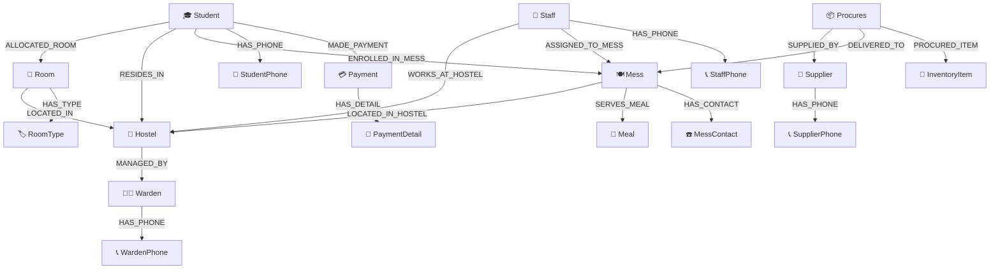

# 🏢 DBS DA3 — University Hostel Administration & Logistics Management System

[](https://vercel.com)
[](https://render.com)
[](https://neo4j.com/cloud/aura/)
[](#-the-18-graph-entities--relationship-ontology)
[](https://react.dev)
[](LICENSE)

A modern, high-performance **University Hostel Administration & Campus Logistics Management System** powered by **React 18**, **Vite**, **Node.js**, **Express**, and a native graph database on **Neo4j AuraDB**.

The platform equips university administrators, residence wardens, mess caterers, and accounting staff with an enterprise-grade operational hub for resident student allocation, multi-block room reservations, dining hall provisioning, staff payroll, vendor procurement, pre-compiled analytical intelligence reporting, and full-spectrum graph / Cypher execution.

---

## 🏛 System Architecture

```text
┌────────────────────────────────────────────────────────────────────────────────┐
│                                CLIENT TIER                                     │
│   Vercel Edge Platform — React 18 Single-Page Application (Vite Bundler)       │
│   • Cosmic Midnight SaaS Design System (Tailored Dark Theme & Micro-FX)        │
│   • Client-Side State Router (Zero Page-Reload Navigation)                     │
│   • Interactive Modals & Entity Graph Referential Warnings                     │
│   • Dynamic Base API URL via VITE_API_URL pointing to Render                   │
└──────────────────────────────────────┬─────────────────────────────────────────┘
                                       │ HTTPS REST API / JSON Payloads
                                       │ (CORS Enabled for Vercel Domains)
┌──────────────────────────────────────▼─────────────────────────────────────────┐
│                                SERVER TIER                                     │
│   Render Web Service — Node.js + Express REST API Server                       │
│   • Connection Pool with Singleton official neo4j-driver (v5.28+)              │
│   • Standardized JSON Envelopes & Error Sanitization                           │
│   • Cypher Query Normalizer (Unwrapping Neo4j Integers to Native JS Numbers)   │
│   • Real-Time Health & Database Telemetry (/api/health)                        │
└──────────────────────────────────────┬─────────────────────────────────────────┘
                                       │ neo4j+s:// Protocol over TLS 1.3 (Encrypted)
┌──────────────────────────────────────▼─────────────────────────────────────────┐
│                               DATABASE TIER                                    │
│   Neo4j AuraDB (Fully Managed Cloud Graph Database)                            │
│   • URI: neo4j+s://78fcafdc.databases.neo4j.io                                 │
│   • 18 Structured Node Labels with Graph Relationships & Uniqueness Constraints │
│   • ACID Compliant Graph Transactions & High-Performance Cypher Traversals     │
└────────────────────────────────────────────────────────────────────────────────┘
```

---

## 📋 Table of Contents

- [Core System Features & Capabilities](#-core-system-features--capabilities)
- [The 18 Graph Entities & Relationship Ontology](#-the-18-graph-entities--relationship-ontology)
- [Graph Data Model & Relationships](#-graph-data-model--relationships)
- [Detailed Functionalities Breakdown](#-detailed-functionalities-breakdown)
  - [1. Executive Operations Dashboard](#1-executive-operations-dashboard)
  - [2. Student Profile & Resident Management](#2-student-profile--resident-management)
  - [3. Hostel Building & Block Administration](#3-hostel-building--block-administration)
  - [4. Room Inventory & Vacancy Tracking](#4-room-inventory--vacancy-tracking)
  - [5. Room Classification Catalog](#5-room-classification-catalog)
  - [6. Warden Administration & Contact Registry](#6-warden-administration--contact-registry)
  - [7. Mess Facilities & Dining Hall Operations](#7-mess-facilities--dining-hall-operations)
  - [8. Meal Menus, Scheduling & Pricing](#8-meal-menus-scheduling--pricing)
  - [9. Staff Workforce & Payroll Directory](#9-staff-workforce--payroll-directory)
  - [10. Supplier Network & Vendor Registry](#10-supplier-network--vendor-registry)
  - [11. Consumable Inventory & Provision Tracking](#11-consumable-inventory--provision-tracking)
  - [12. Procurement Ledger & Purchase Batches](#12-procurement-ledger--purchase-batches)
  - [13. Student Billing & Payment Transactions](#13-student-billing--payment-transactions)
  - [14. 13 Pre-Compiled Graph Analytical Reports](#14-13-pre-compiled-graph-analytical-reports)
  - [15. Interactive Cypher & SQL Query Studio](#15-interactive-cypher--sql-query-studio)
  - [16. 18 Dedicated Entity Table Explorers](#16-18-dedicated-entity-table-explorers)
- [Complete REST API Reference](#-complete-rest-api-reference)
- [Repository Structure](#-repository-structure)
- [Local Installation & Setup Guide](#-local-installation--setup-guide)
- [Environment Variables Reference](#-environment-variables-reference)
- [Render Deployment Guide (Backend)](#-render-deployment-guide-backend)
- [Vercel Deployment Guide (Frontend)](#-vercel-deployment-guide-frontend)
- [Important Security Notes](#-important-security-notes)
- [License](#-license)

---

## 🌟 Core System Features & Capabilities

- **Native Neo4j AuraDB Graph Engine**: Powered by managed Neo4j AuraDB over `neo4j+s://` encrypted TLS connections using the official `neo4j-driver` (v5.28+). Zero dependency on legacy MySQL/Aiven.
- **18 Graph Entities & Node Labels**: Complete schema modeling all 18 core domain entities (students, rooms, hostels, wardens, mess halls, meals, staff, suppliers, inventory, procurements, payments, and multi-valued contact phone nodes).
- **Expressive Relationship Traversals**: Real graph relationships (`ALLOCATED_ROOM`, `RESIDES_IN`, `MANAGED_BY`, `LOCATED_IN`, `ENROLLED_IN_MESS`, `SUPPLIED_BY`, `PROCURED_ITEM`, `MADE_PAYMENT`) replacing slow multi-way relational SQL JOINs with lightning-fast graph pointer hops.
- **Full-Spectrum Cypher & SQL Studio**: Directly run native Cypher queries (`MATCH`, `CREATE`, `SET`, `DELETE`, `RETURN`) alongside SQL commands with automatic Cypher translation fallback, result visualization, execution timing, and CSV export.
- **13 Multi-Entity Graph Reports**: Pre-compiled analytical queries computing resident assignments, occupancy percentages, financial summaries, and inventory stock health with millisecond profiling and 1-click CSV export.
- **18 Dedicated Entity Explorer Views**: Dedicated UI screens for each entity displaying 100% of attributes and graph nodes with search, pagination, and inline CRUD.
- **Production Health Verification**: Live endpoint (`GET /api/health`) querying the active Neo4j AuraDB database and reporting node counts, connection state, and round-trip latency.
- **Decoupled Cloud Deployments**: Frontend deploys to **Vercel** with SPA rewrites; backend deploys to **Render** with dynamic CORS and environment variable injection.

---

## 🗄 The 18 Graph Entities & Relationship Ontology

| Entity / Node Label | Role & Domain Description | Primary Identifier | Outgoing / Incoming Relationships |
| :--- | :--- | :--- | :--- |
| **`Warden`** | Residential block administrators and faculty overseers. | `WardenID` | `<-[:MANAGED_BY]- (Hostel)`, `-[:HAS_PHONE]-> (WardenPhone)` |
| **`WardenPhone`** | Multi-valued telephone numbers for wardens. | Composite | `<-[:HAS_PHONE]- (Warden)` |
| **`Hostel`** | Campus residence blocks and halls of residence. | `HostelID` | `-[:MANAGED_BY]-> (Warden)`, `<-[:LOCATED_IN]- (Room)` |
| **`RoomType`** | Classification catalog (Single, Double, AC, Non-AC) and base rent. | `Type` | `<-[:HAS_TYPE]- (Room)` |
| **`Room`** | Physical room inventory, floor allocations, and occupancy states. | `RoomNo` | `-[:LOCATED_IN]-> (Hostel)`, `-[:HAS_TYPE]-> (RoomType)` |
| **`Student`** | Enrolled university residents residing across campus hostels. | `StudentID` | `-[:ALLOCATED_ROOM]-> (Room)`, `-[:RESIDES_IN]-> (Hostel)`, `-[:ENROLLED_IN_MESS]-> (Mess)` |
| **`StudentPhone`** | Multi-valued mobile contact numbers for residents. | Composite | `<-[:HAS_PHONE]- (Student)` |
| **`Mess`** | Dining hall facilities and catering operations. | `MessID` | `-[:LOCATED_IN_HOSTEL]-> (Hostel)`, `<-[:ASSIGNED_TO_MESS]- (Staff)` |
| **`MessContact`** | Operational helpline numbers for mess caterers. | Composite | `<-[:HAS_CONTACT]- (Mess)` |
| **`Meal`** | Dining menus, daily serving schedules, and fixed pricing. | `MealID` | `-[:SERVED_BY_MESS]-> (Mess)` |
| **`Staff`** | Maintenance crew, cooks, cleaning personnel, and security guards. | `StaffID` | `-[:WORKS_AT_HOSTEL]-> (Hostel)`, `-[:ASSIGNED_TO_MESS]-> (Mess)` |
| **`StaffPhone`** | Emergency contact numbers for operational personnel. | Composite | `<-[:HAS_PHONE]- (Staff)` |
| **`Supplier`** | Approved campus vendors supplying provisions and inventory. | `SupplierID` | `<-[:SUPPLIED_BY]- (Procures)`, `-[:HAS_PHONE]-> (SupplierPhone)` |
| **`SupplierPhone`** | Contact phone directory for vendors. | Composite | `<-[:HAS_PHONE]- (Supplier)` |
| **`InventoryItem`** | Stock ledger for perishable foodstuffs and hostel consumables. | `ItemID` | `<-[:PROCURED_ITEM]- (Procures)` |
| **`Procures`** | Purchase batch hyperedges linking Supplier, Mess, and Items. | `ProcureID` | `-[:SUPPLIED_BY]-> (Supplier)`, `-[:DELIVERED_TO]-> (Mess)`, `-[:PROCURED_ITEM]-> (InventoryItem)` |
| **`Payment`** | Ledger transactions, fee collections, and payment statuses. | `PaymentID` | `<-[:MADE_PAYMENT]- (Student)`, `-[:HAS_DETAIL]-> (PaymentDetail)` |
| **`PaymentDetail`** | Line-item billing breakdowns (Room Rent, Mess Fee, Amenities). | `DetailID` | `<-[:HAS_DETAIL]- (Payment)` |

---

## 🕸 Graph Data Model & Relationships



---

## 🚀 Detailed Functionalities Breakdown

### 1. Executive Operations Dashboard
- Live KPI counter cards: Total Residents, Total Hostels, Occupancy Rate, Total Staff, Active Suppliers, and Total Revenue collected.
- Capacity & Occupancy telemetry per hostel block calculated via live Cypher aggregations.
- Recent billing transactions and real-time Neo4j round-trip database ping.

### 2. Student Profile & Resident Management
- Complete CRUD interface for resident students.
- Automatic creation of graph relationships (`ALLOCATED_ROOM`, `RESIDES_IN`, `ENROLLED_IN_MESS`).
- Dynamic search by student name, roll number, hostel, and gender.

### 3. Hostel Building & Block Administration
- Management of campus residential buildings and wardens.
- Tracks real-time occupancy counts vs. total capacities.

### 4. Room Inventory & Vacancy Tracking
- Room occupancy tracking across all blocks and floor levels.
- Direct synchronization with `RoomType` catalog base rents.

### 5. Room Classification Catalog
- Configurable room classifications (Single AC, Double Non-AC, Deluxe Suite).
- Defines base rents and capacity constraints inherited by physical rooms.

### 6. Warden Administration & Contact Registry
- Faculty warden directory linked to managed residential blocks.
- Multi-valued telephone numbers stored as native graph nodes.

### 7. Mess Facilities & Dining Hall Operations
- Dining halls mapped to residential halls.
- Meal plans, operational staff counts, and catering contacts.

### 8. Meal Menus, Scheduling & Pricing
- Timetables and pricing for Breakfast, Lunch, Snacks, and Dinner.

### 9. Staff Workforce & Payroll Directory
- Campus operational workforce (Electricians, Cleaners, Cooks, Security).
- Assigns staff to specific hostel blocks and mess kitchens.

### 10. Supplier Network & Vendor Registry
- Approved food and supply vendor records.
- Contact numbers and delivery logs.

### 11. Consumable Inventory & Provision Tracking
- Real-time stock counts, units of measurement, and unit prices.

### 12. Procurement Ledger & Purchase Batches
- Procurement orders linking Supplier, Mess, and Inventory Items in a single graph hyperedge.
- Tracks order dates, delivered quantities, and total procurement expenses.

### 13. Student Billing & Payment Transactions
- Student fee collection records (Paid, Pending, Failed).
- Itemized payment line items (`PaymentDetail`).

### 14. 13 Pre-Compiled Graph Analytical Reports
1. **Student Complete Profile**: Full graph traversal joining Student, Room, Hostel, Mess, and phone contacts.
2. **Room Occupancy Analysis**: Block-by-block vacancy and capacity ratios.
3. **Hostel Administration Directory**: Wardens and contact phones for each block.
4. **Mess Operations & Capacity**: Dining halls, served hostels, and enrolled resident counts.
5. **Daily Meal Catalog**: Complete menus, meal schedules, and pricing.
6. **Campus Workforce Directory**: Staff roles, allocated facilities, and emergency contacts.
7. **Approved Supplier Network**: Vendor profiles, contact information, and supplied goods.
8. **Inventory Stock Status**: Inventory volume, unit valuation, and total stock worth.
9. **Procurement Ledger**: Detailed purchase batches cross-referencing Mess, Supplier, and Items.
10. **Student Financial Summary**: Aggregated payments, pending dues, and payment methods.
11. **Itemized Billing Details**: Granular breakdown of individual fees.
12. **High-Occupancy Blocks**: Analytical ranking of hostel buildings with >85% occupancy.
13. **Comprehensive Campus Ledger**: Consolidated audit trail of all campus operations.

### 15. Interactive Cypher & SQL Query Studio
- **Native Cypher Execution**: Execute any Cypher query directly against Neo4j AuraDB.
- **SQL Compatibility Mode**: Accepts standard SQL statements (`SELECT`, `INSERT`, `UPDATE`, `DELETE`) and translates them to equivalent Cypher graph queries.
- Instant tabular visualization, execution latency profiling, and 1-click CSV download.

### 16. 18 Dedicated Entity Table Explorers
- Dedicated view for all 18 database entities.
- Full attribute inspection, live search, and inline CRUD.

---

## 📡 Complete REST API Reference

| Domain | Endpoint | HTTP Methods | Description |
| :--- | :--- | :--- | :--- |
| **Health** | `/api/health` | `GET` | Validates active Neo4j AuraDB connectivity, node counts, and latency. |
| **Dashboard** | `/api/dashboard/stats` | `GET` | System-wide KPI summary, occupancy ratios, and financial metrics. |
| **Students** | `/api/students` | `GET`, `POST`, `PUT /:id`, `DELETE /:id` | Resident student profiles & graph relationship management. |
| **Hostels** | `/api/hostels` | `GET`, `POST`, `PUT /:id`, `DELETE /:id` | Residence block CRUD & warden assignment. |
| **Rooms** | `/api/rooms` | `GET`, `POST`, `PUT /:id`, `DELETE /:id` | Room inventory & occupancy management. |
| **Room Types** | `/api/room-types` | `GET`, `POST`, `PUT /:id`, `DELETE /:id` | Classification catalog & rent configurations. |
| **Wardens** | `/api/wardens` | `GET`, `POST`, `PUT /:id`, `DELETE /:id` | Warden administrative registry & phone contacts. |
| **Mess Halls** | `/api/mess` | `GET`, `POST`, `PUT /:id`, `DELETE /:id` | Dining hall management & capacity. |
| **Meals** | `/api/meals` | `GET`, `POST`, `PUT /:id`, `DELETE /:id` | Meal scheduling, menus, and pricing. |
| **Staff** | `/api/staff` | `GET`, `POST`, `PUT /:id`, `DELETE /:id` | Workforce directory & facility assignments. |
| **Suppliers** | `/api/suppliers` | `GET`, `POST`, `PUT /:id`, `DELETE /:id` | Vendor catalog & contact numbers. |
| **Inventory** | `/api/inventory` | `GET`, `POST`, `PUT /:id`, `DELETE /:id` | Consumable stock ledger. |
| **Procurements** | `/api/procurements` | `GET`, `POST`, `DELETE` | Purchase batch records. |
| **Payments** | `/api/payments` | `GET`, `POST`, `DELETE /:id` | Payment transactions & line-item details. |
| **Reports** | `/api/reports/:id` | `GET` | 13 pre-compiled analytical graph reports. |
| **Table Explorer** | `/api/tables/:tableName` | `GET`, `POST`, `PUT /:id`, `DELETE /:id` | Dynamic CRUD for all 18 entities. |
| **Query Studio** | `/api/query` | `POST` | Arbitrary Cypher and translated SQL execution. |

---

## 📁 Repository Structure

```text
dbs-DA3/
├── database/
│   ├── schema_neo4j.cypher     # Neo4j AuraDB DDL (Constraints, Indexes, Schema Ontology)
│   ├── schema.sql              # Original relational schema reference
│   └── seed.sql                # Original seed data reference
│
├── backend/
│   ├── package.json            # Node.js dependencies (neo4j-driver, express, cors, dotenv)
│   ├── server.js               # Express application entry point & health check
│   ├── database.js             # Unified database access adapter
│   ├── db-neo4j.js             # Singleton Neo4j connection pool, normalizer, and seeder
│   ├── test-connection.js      # Neo4j AuraDB connectivity verification test
│   ├── test-endpoints-and-crud.js # Full integration test suite (5 endpoints + 12 CRUD tests)
│   ├── verify-neo4j.js         # Graph entity node and relationship count verifier
│   ├── .env.example            # Backend environment template (safe placeholders)
│   └── routes/                 # Express REST route controllers (Cypher-powered)
│       ├── dashboard.js        # KPI summaries & occupancy aggregations
│       ├── students.js         # Student profile CRUD & graph relationships
│       ├── hostels.js          # Residence block CRUD
│       ├── rooms.js            # Room inventory CRUD
│       ├── roomTypes.js        # Room classification CRUD
│       ├── wardens.js          # Warden administration CRUD
│       ├── mess.js             # Mess dining facility CRUD
│       ├── meals.js            # Meal menu & pricing CRUD
│       ├── staff.js            # Workforce & facility allocation CRUD
│       ├── suppliers.js        # Vendor registry CRUD
│       ├── inventory.js        # Inventory catalog CRUD
│       ├── procurements.js     # Purchase batch hyperedge CRUD
│       ├── payments.js         # Payment billing & line-item CRUD
│       ├── reports.js          # 13 Multi-Entity analytical graph reports
│       ├── tables.js           # Dynamic 18-entity graph explorer engine
│       └── query.js            # Universal Cypher & SQL execution engine
│
├── frontend/
│   ├── index.html              # HTML5 application shell & SVG favicon
│   ├── package.json            # React 18, Vite 6, Lucide React
│   ├── vite.config.js          # Vite configuration & dev proxy
│   ├── vercel.json             # Vercel SPA client-side rewrite rules
│   └── src/
│       ├── index.css           # Cosmic Midnight design system
│       ├── main.jsx            # React root mount
│       ├── App.jsx             # Application router & toast notification container
│       ├── services/api.js     # Unified API service with dynamic backend resolution
│       ├── components/         # Reusable UI components (Navbar, Sidebar, Modals)
│       └── pages/              # View pages (Dashboard, Reports, Query Studio, Tables)
│
├── render.yaml                 # Render Blueprint configuration for automated backend deployment
├── vercel.json                 # Root Vercel configuration for frontend deployment
├── .env.example                # Root environment template (safe placeholders)
├── .gitignore                  # Git exclusions (.env, node_modules, dist)
└── README.md                   # Complete system documentation
```

---

## 🛠 Local Installation & Setup Guide

### Prerequisites
- **Node.js**: Version `>= 18.0.0`
- **npm**: Version `>= 9.0.0`
- **Git**: Installed and configured
- **Neo4j AuraDB Account**: Active cloud instance

### 1. Clone the Repository
```bash
git clone https://github.com/nishanth418/dbs-DA3.git
cd dbs-DA3
```

### 2. Configure Backend Environment
Copy `.env.example` to `backend/.env`:
```bash
cp .env.example backend/.env
```
Edit `backend/.env` with your actual Neo4j AuraDB credentials:
```env
PORT=5000
NODE_ENV=development

NEO4J_URI=neo4j+s://78fcafdc.databases.neo4j.io
NEO4J_USERNAME=78fcafdc
NEO4J_PASSWORD=YOUR_ACTUAL_NEO4J_PASSWORD
NEO4J_DATABASE=78fcafdc
```

### 3. Install Dependencies & Start Backend
```bash
cd backend
npm install
npm start
```
The backend will automatically:
1. Establish a connection to Neo4j AuraDB.
2. Initialize uniqueness constraints and indexes.
3. Seed baseline records for all 18 entities (idempotent `MERGE`).
4. Establish all graph relationships.
5. Launch the Express server at `http://localhost:5000`.

To verify connectivity:
```bash
node test-connection.js
node test-endpoints-and-crud.js
```

### 4. Install Dependencies & Start Frontend
In a new terminal window:
```bash
cd frontend
npm install
npm run dev
```
The React development server will start at `http://localhost:3000` and proxy `/api` requests to `http://localhost:5000`.

---

## 🔐 Environment Variables Reference

| Variable Name | Required By | Environment | Description | Example / Default |
| :--- | :--- | :--- | :--- | :--- |
| `NEO4J_URI` | Backend | Dev / Prod (Render) | Neo4j AuraDB connection protocol and host | `neo4j+s://78fcafdc.databases.neo4j.io` |
| `NEO4J_USERNAME` | Backend | Dev / Prod (Render) | Neo4j database user | `78fcafdc` |
| `NEO4J_PASSWORD` | Backend | Dev / Prod (Render) | Neo4j AuraDB secret password | *(Your private password)* |
| `NEO4J_DATABASE` | Backend | Dev / Prod (Render) | Neo4j database name | `78fcafdc` |
| `PORT` | Backend | Dev / Prod (Render) | HTTP server port | `5000` (Dev) / Assigned by Render (Prod) |
| `NODE_ENV` | Backend | Dev / Prod (Render) | Node runtime environment | `production` |
| `VITE_API_URL` | Frontend | Prod (Vercel) | Public URL of deployed Render backend | `https://your-backend.onrender.com` |

---

## ☁️ Render Deployment Guide (Backend)

The backend is fully configured for zero-downtime deployment on Render.

### Option A: Using `render.yaml` Blueprint (Recommended)
1. Log in to [Render Dashboard](https://dashboard.render.com).
2. Click **New +** → **Blueprint**.
3. Connect your repository: `https://github.com/nishanth418/dbs-DA3`.
4. Render will parse `render.yaml` automatically.
5. In the Environment Variables prompt, fill in:
   - `NEO4J_PASSWORD`: Enter your Neo4j AuraDB password.
6. Click **Apply**. Render will build and deploy the web service.

### Option B: Manual Web Service Setup
1. On Render, click **New +** → **Web Service**.
2. Connect `https://github.com/nishanth418/dbs-DA3`.
3. Configure the following parameters:
   - **Name**: `dbs-da3-backend`
   - **Region**: Oregon (or nearest)
   - **Root Directory**: `backend`
   - **Environment**: `Node`
   - **Build Command**: `npm install`
   - **Start Command**: `node server.js`
   - **Health Check Path**: `/api/health`
4. Add the Environment Variables:
   - `NEO4J_URI` = `neo4j+s://78fcafdc.databases.neo4j.io`
   - `NEO4J_USERNAME` = `78fcafdc`
   - `NEO4J_PASSWORD` = `<YOUR_NEO4J_PASSWORD>`
   - `NEO4J_DATABASE` = `78fcafdc`
   - `NODE_ENV` = `production`
5. Click **Create Web Service**.
6. Once deployed, note down your Render public URL (e.g. `https://dbs-da3-backend.onrender.com`).

---

## ⚡ Vercel Deployment Guide (Frontend)

The frontend is an optimized Vite React SPA configured for Vercel.

1. Log in to [Vercel Dashboard](https://vercel.com).
2. Click **Add New...** → **Project**.
3. Import the repository: `https://github.com/nishanth418/dbs-DA3`.
4. In the Project Configuration:
   - **Framework Preset**: `Vite`
   - **Root Directory**: `frontend` (or leave default if using root `vercel.json`)
   - **Build Command**: `npm run build`
   - **Output Directory**: `dist`
5. Under **Environment Variables**, add:
   - `VITE_API_URL` = `https://your-backend.onrender.com` *(Replace with your live Render backend URL)*
6. Click **Deploy**.
7. Vercel will build the frontend and provide a global edge URL.
8. The frontend will automatically communicate with your Render backend over HTTPS with CORS enabled.

---

## 🔒 Important Security Notes

- **Zero Secrets Committed**: All passwords, API tokens, and `.env` files are strictly excluded via `.gitignore`.
- **Parametric Cypher**: All backend endpoints use parameterized Cypher queries (`$param`) preventing Cypher injection attacks.
- **Sanitized Errors**: Database error messages returned to the client are sanitized to prevent internal schema or credential leakage.
- **Strict TLS 1.3**: Communication with Neo4j AuraDB is encrypted end-to-end via the `neo4j+s://` protocol.

---

## 📄 License

This project is licensed under the **MIT License** — feel free to use, modify, and distribute for educational and commercial applications.
